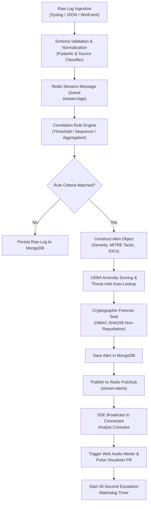
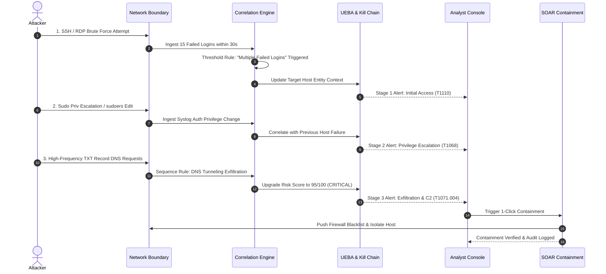
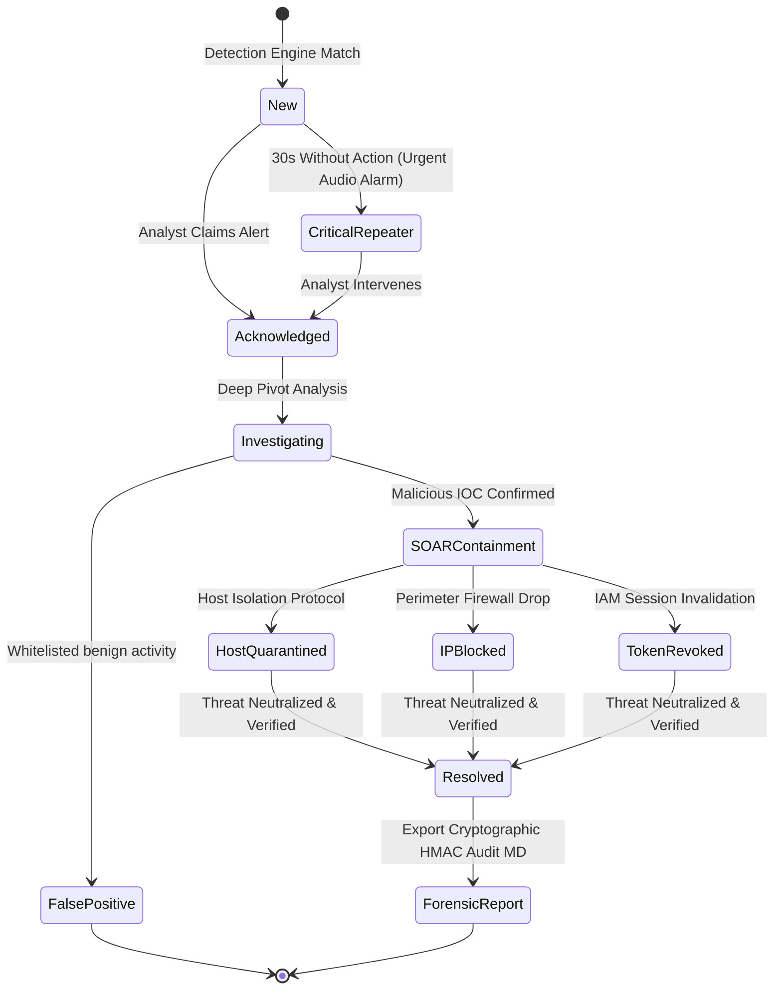

# 🛡️ Next-Gen Enterprise SIEM & SOAR Platform
### Unified Threat Detection, Automated SOAR Containment, MITRE ATT&CK® Navigator, UEBA & Cryptographic Forensics

[](LICENSE)
[](https://www.python.org/)
[](https://react.dev/)
[](https://www.typescriptlang.org/)
[](https://redis.io/)
[](https://www.mongodb.com/)
[](https://attack.mitre.org/)
[](https://github.com/SigmaHQ/sigma)
[](https://www.w3.org/WAI/WCAG21/quickref/)

---

## 📌 Executive Summary

Modern Security Operations Centers (SOCs) are burdened by **alert fatigue**, **fragmented point solutions**, **high ingestion costs**, and **excessive Mean Time to Detect (MTTD) and Mean Time to Respond (MTTR)**. Legacy SIEM solutions act merely as passive log repositories, requiring external orchestration tools and costly manual analyst interventions.

This **Next-Generation Security Information and Event Management (SIEM) & Security Orchestration, Automation, and Response (SOAR)** platform solves these challenges in a unified, sub-second latency architecture:
- **Sub-Second Log Processing**: Ingests, normalizes, and correlates high-throughput event telemetry across Syslog, Windows Event Logs, and Network firewalls via Redis Streams.
- **Active Defense (SOAR)**: Bridges passive detection to active containment with 1-click & automated firewall IP drops, host network quarantine, and IAM credential revocations.
- **Full MITRE ATT&CK® Enterprise Navigator**: Real-time matrix heatmaps mapping 14 tactical kill chain phases and adversary techniques.
- **Multi-Source Threat Intelligence (TI)**: Automated on-demand IOC enrichment against AbuseIPDB, VirusTotal, AlienVault OTX, and Shodan.
- **User & Entity Behavior Analytics (UEBA)**: Baselines normal operational activity to flag statistical anomalies and multi-stage attack chains.
- **Sigma Rule Standard**: Native interoperability with Sigma detection rules, enabling immediate import/export and YAML inspection.
- **Court-Admissible Forensics**: Cryptographic HMAC-SHA256 non-repudiation sealing and 1-click forensic incident reporting.
- **Tactical SOC Interface**: Audio alert notification chime with Web Audio visualizer pill, 30-second automated re-escalation, local time-adaptive historical graph controls, and WCAG AA high-contrast dark theme.

---

## 🏛️ System Architecture

The platform follows an asynchronous, event-driven microservices architecture partitioned into ingestion, correlation, persistence, orchestration, and visualization tiers:

```
+----------------------------------------------------------------------------------------------------+
|                                    DISTRIBUTED LOG INGESTION LAYER                                 |
|  [Windows Event Logs]       [Syslog / RFC 5424]       [Network Firewalls]       [Cloud Audit Logs] |
+----------------------------------------------------------------------------------------------------+
                                                  │
                                                  ▼
+────────────────────────────────────────────────────────────────────────────────────────────────────+
|                                    REDIS STREAMS BUFFER & PUB/SUB                                  |
|  - Ingestion FIFO Queues (`stream:logs`)               - Asynchronous Real-Time Event Dispatch      |
|  - Backpressure Absorption & Rate Limiting             - SSE Broadcast Channel (`stream:alerts`)   |
+────────────────────────────────────────────────────────────────────────────────────────────────────+
                                                  │
                  ┌───────────────────────────────┴───────────────────────────────┐
                  ▼                                                               ▼
+───────────────────────────────────────────────+ +──────────────────────────────────────────────────+
|           EVENT PERSISTENCE TIER              | |           REAL-TIME CORRELATION ENGINE           |
|  [MongoDB Time-Series / Document Store]       | |  - Threshold-Based Anomaly Detectors             |
|  - Raw & Normalized Log Repositories          | |  - State-Machine Multi-Stage Attack Chains       |
|  - Aggregation Time-Bucketing Pipelines       | |  - Sliding Window Aggregation Correlators        |
|  - Cryptographic Chain-of-Custody Store       | |  - Sigma Rule Evaluator & YAML Exporter          |
+───────────────────────────────────────────────+ +──────────────────────────────────────────────────+
                  │                                                               │
                  └───────────────────────────────┬───────────────────────────────┘
                                                  ▼
+────────────────────────────────────────────────────────────────────────────────────────────────────+
|                                FLASK CORE REST & STREAMING API (PORT 5000)                         |
|  - JWT / Argon2id Authentication & RBAC               - SSE Real-Time Streaming (`/v1/alerts/stream`)|
|  - MITRE ATT&CK® Correlation Engine                   - Threat Intelligence Orchestrator (TI)      |
|  - SOAR Automated Containment Dispatcher              - UEBA Statistical Scoring Engine            |
|  - HMAC-SHA256 Digital Forensic Signature Service     - Scenario Simulation Controller             |
+────────────────────────────────────────────────────────────────────────────────────────────────────+
                                                  │
                  ┌───────────────────────────────┴───────────────────────────────┐
                  ▼                                                               ▼
+───────────────────────────────────────────────+ +──────────────────────────────────────────────────+
|            ACTIVE SOAR CONTAINMENT            | |         THREAT INTELLIGENCE ENRICHMENT           |
|  - Automated Firewall IP Drop (iptables/null) | |  - AbuseIPDB Confidence Scores                   |
|  - Host Isolation / Quarantine (eBPF/EDR)     | |  - VirusTotal Malware & Hash Lookups             |
|  - IAM Credential Revocation & Token Flush    | |  - AlienVault OTX Threat Pulses & Shodan Lookup  |
+───────────────────────────────────────────────+ +──────────────────────────────────────────────────+
                                                  │
                                                  ▼
+────────────────────────────────────────────────────────────────────────────────────────────────────+
|                                 ANALYST COMMAND CONSOLE (PORT 5173)                                |
|  - React 19 + TypeScript + Vite + Zustand              - Visx Time-Series Graph with Local Time Nav|
|  - MITRE ATT&CK Enterprise Matrix Navigator Modal      - Real-Time Audio Alerter & FFT Visualizer  |
|  - 30s Unacknowledged Alert Escalation Watchdog        - WCAG AA High-Contrast SOC Theme Polish    |
|  - 1-Click Forensic Incident Report Generator (MD)     - Optimistic UI Transitions & IOC Cloner    |
+────────────────────────────────────────────────────────────────────────────────────────────────────+
```

---

## 🔄 Execution & Incident Lifecycle Flowcharts

### 1. End-to-End Log Ingestion & Detection Flow


### 2. Multi-Stage Attack Correlation & Kill Chain Progression


### 3. Alert Lifecycle & SOAR Automated Containment


---

## 🎯 Key Functions & Modules

| Module | Core Functionality | Technical Highlights |
| :--- | :--- | :--- |
| **Real-Time Correlation Engine** | Evaluates live streaming events against composite stateful rules. Supports **Threshold** (rate anomalies), **Sequence** (multi-stage progression within time window), and **Aggregation** (group-by deviations). | In-memory sliding windows with Redis Streams; sub-10ms evaluation latency. |
| **Active SOAR Defense** | Executes containment workflows straight from the alert triage view: Automated Firewall IP Drop, Host Network Isolation, and IAM Session Invalidation. | RESTful containment API, mockable defense drivers, execution audit logging. |
| **MITRE ATT&CK® Navigator** | Dynamic interactive enterprise matrix mapping alerts across all 14 tactics (Reconnaissance to Impact). Displays coverage heatmaps and technique definitions. | Visual modal overlay, color-coded technique densities, direct filtering by tactic. |
| **Threat Intelligence (TI)** | Automatic IOC reputation lookup and external correlation. | AbuseIPDB confidence score, VirusTotal malicious votes, AlienVault OTX pulses, and Shodan linkouts. |
| **UEBA & Anomaly Engine** | User & Entity Behavior Analytics calculates baseline deviation scores (0–100) based on source IPs, user accounts, and off-hour activity. | Cyber Kill Chain progression tracker correlating multi-stage incidents across time. |
| **Sigma Rule Standard** | Translates SIEM detection filters into standard Sigma YAML syntax for vendor-agnostic rule interchange. | Native Sigma YAML export, syntax-highlighted editor, interoperable with SOC Prime & SigmaHQ. |
| **Forensic Integrity Hub** | Generates tamper-proof HMAC-SHA256 digital seals for every alert. Produces court-admissible Markdown case summaries. | Cryptographic verification banner, immutable event hashes, non-repudiation audit trails. |
| **SOC Tactical Interface** | Web Audio alert chimes, live audio frequency visualizer pill, 30s alert re-escalation watchdog, and dual-coded geometric severity badges (`⬢`, `▲`, `◆`, `●`). | Zero-latency Web Audio API synthesizer, Zustand notification bell store, WCAG AA dark palette. |
| **Time-Travel Graph Controls** | Interactive time-series event timeline with local timezone calibration (`+05:30` / IST), 1H–30D presets, and historical day stepping. | `@visx/xychart` with localized bottom axis formatting, responsive container resizing, and zero-fill continuous bucketing. |
| **Adversary Simulator** | Generates real-world realistic multi-stage cyber attacks for analyst training and rule verification. | Pre-configured playbooks: SSH Brute Force, DNS Tunneling, Phishing Payload, and Linux Sudo Privilege Escalation. |

---

## 💼 Real-World Use Cases

### 1. Automated Credential Stuffing Mitigation
- **Scenario**: A distributed botnet attempts tens of thousands of authentication attempts against an organization's public VPN endpoint.
- **Platform Response**: The Aggregation Correlator detects $>10$ failed authentications for distinct usernames from a single subnet in 60 seconds. The platform automatically triggers SOAR firewall blocking, alerts the SOC, queries AbuseIPDB for subnet reputation, and displays the `T1110.004 (Credential Stuffing)` MITRE badge.

### 2. Covert DNS Data Exfiltration
- **Scenario**: An infected workstation queries thousands of pseudo-random subdomains (DGA) to sneak encrypted intellectual property past corporate proxies.
- **Platform Response**: The Sequence Correlator tracks high-frequency TXT/NULL record requests, flags entropy anomalies, and calculates a UEBA score of 88/100. The analyst clicks **Host Network Isolation** to sever the endpoint's socket connections immediately.

### 3. Insider Threat & Privilege Abuse
- **Scenario**: A compromised contractor account accesses sensitive databases outside of business hours and alters system configuration files.
- **Platform Response**: UEBA identifies abnormal login hours coupled with unauthorized `sudoers` modification. A High-Severity alert sounds the tactical audio chime. If unacknowledged within 30 seconds, the system re-alarms the shift lead.

### 4. Zero-Day Community Threat Hunting (Sigma)
- **Scenario**: A new CVE is disclosed with published Sigma detection rules on GitHub.
- **Platform Response**: Security engineers paste the Sigma YAML rule directly into the Rules Manager. The platform's translator parses log sources, conditions, and tags into native SIEM threshold criteria without restarting services.

### 5. Regulatory Compliance & Forensic Audit Preparation
- **Scenario**: External auditors require tamper-proof proof of containment during a ransomware investigation.
- **Platform Response**: The SOC exports the incident's HMAC-SHA256 cryptographically sealed report, complete with verified timestamps, non-repudiation signatures, and containment execution proofs.

---

## ⚖️ Comprehensive Comparison: Why Choose This Platform?

| Capability | This Platform | Splunk Enterprise Security | Elastic Security (ELK) | Microsoft Sentinel | Wazuh (OSSEC) |
| :--- | :---: | :---: | :---: | :---: | :---: |
| **Ingestion Pipeline** | **Ultra-Low Latency Redis Streams** | Heavy Forwarders / Splunk Indexers | Logstash / Beats / Kafka | Azure Monitor Agent | Wazuh Agent daemon |
| **Native SOAR (1-Click Defense)** | **Built-in (Zero extra cost)** | Separate tool (Splunk SOAR / Phantom) | Limited basic action rules | Requires Azure Logic Apps (Paid) | Active Response scripts only |
| **MITRE ATT&CK Matrix Navigator** | **Built-in Real-Time Interactive Matrix** | Premium App add-on | Pre-built rules matrix | Workbooks add-on | Static rule mapping |
| **Sigma Rule Standard** | **Native YAML View & Translation** | Requires external `sigmac` tool | Partial EQL support | Requires KQL translation | Requires translation |
| **Forensic Cryptographic Seal** | **HMAC-SHA256 Non-Repudiation** | Paid Audit compliance app | Third-party hashing required | Azure Immutable Storage (Cost) | Digest verification |
| **Hardware & Resource Footprint** | **Minimal (~250 MB RAM, runs natively)** | Extremely Heavy (16–32 GB RAM min) | Heavy (8–16 GB RAM min) | Cloud-only (Azure billing overhead) | Moderate (4–8 GB RAM) |
| **Attack Scenario Simulation Engine** | **Built-in multi-stage playbooks** | External (Splunk Attack Range) | None (Requires external tools) | None (Requires Azure test scripts) | None |
| **Cost & Licensing** | **Open Source (AGPLv3)** | \$1,500+ / GB/day licensing | Elastic tiered subscription | Pay-per-GB ingestion billing | Open Source |

---

## 🚀 Quick Start Guide

### System Prerequisites
- **Python**: 3.10, 3.11, or 3.12
- **Node.js**: v18.0.0 or higher & `pnpm` (or `npm`)
- **MongoDB**: v7.0 or v8.0 running on `localhost:27017`
- **Redis**: v7.x running on `localhost:6379`

---

### Step 1: Clone the Repository
```bash
git clone https://github.com/vidhi726/siem.git
cd siem
```

---

### Step 2: Backend Configuration & Startup
```bash
# Navigate to the backend directory
cd PROJECTS/intermediate/siem-dashboard/backend

# Create and activate Python virtual environment
python -m venv .venv

# Windows:
.\.venv\Scripts\activate
# Linux/macOS:
# source .venv/bin/activate

# Install dependencies
pip install -r requirements.txt

# Run database seed to populate users, rules, and scenarios
python -m scripts.seed

# Launch Flask API server (Port 5000)
python -m flask run --host 0.0.0.0 --port 5000
```

---

### Step 3: Frontend Installation & Launch
```bash
# In a new terminal, navigate to the frontend directory
cd PROJECTS/intermediate/siem-dashboard/frontend

# Install frontend packages
pnpm install

# Start Vite development server (Port 5173)
pnpm run dev --host 0.0.0.0 --port 5173
```

---

### Step 4: Docker Compose Deployment (One-Click)
```bash
# In the project root or siem-dashboard directory:
docker compose up -d
```
The full platform will be live at `http://localhost:5173` (or `http://localhost:8431` via Docker).

---

## 🔑 Default Credentials

| Role | Username | Password | Permissions |
| :--- | :--- | :--- | :--- |
| **Administrator** | `admin` | `Password123!` | Full admin access, Rule creation, SOAR containment, User management |
| **SOC Analyst** | `analyst` (or `vidhi`) | `Password123!` | Alert triage, Incident investigation, Forensics export, Scenario triggers |

---

## 📡 REST API & Streaming Endpoints

### Authentication (`/v1/auth`)
- `POST /v1/auth/login` — Authenticate and receive JWT access & refresh tokens.
- `GET /v1/auth/me` — Retrieve authenticated user profile and permissions.

### Analytics & Dashboard (`/v1/dashboard`)
- `GET /v1/dashboard` — High-level SOC metrics, event counts, open alert ratios.
- `GET /v1/dashboard/timeline?hours=24&bucket_minutes=15&offset_days=0` — Localized, continuous time-series telemetry.
- `GET /v1/dashboard/severity-breakdown` — Severity distribution metrics.
- `GET /v1/dashboard/top-sources?limit=10` — Highest-volume suspicious source IPs.

### Alerts & SOAR (`/v1/alerts`)
- `GET /v1/alerts` — Paginated, filterable alerts with MITRE tactics and severity levels.
- `GET /v1/alerts/<id>` — Deep inspection of alert, matched logs, and forensic hash.
- `PATCH /v1/alerts/<id>/status` — Optimistic state updates (`new`, `acknowledged`, `investigating`, `resolved`).
- `POST /v1/alerts/<id>/soar` — Execute active containment action (`block_ip`, `isolate_host`, `revoke_credentials`).
- `GET /v1/alerts/mitre-matrix` — Comprehensive MITRE ATT&CK coverage matrix JSON.
- `GET /v1/alerts/stream` — Real-time Server-Sent Events (SSE) alert broadcast stream.

### Detection Rules & Sigma (`/v1/rules`)
- `GET /v1/rules` — List active detection rules (Threshold, Sequence, Aggregation).
- `POST /v1/rules` — Register new custom correlation rule.
- `GET /v1/rules/<id>/sigma` — Export rule in standard Sigma YAML specification.
- `POST /v1/rules/<id>/test` — Dry-run rule against historical telemetry.

### Attack Scenarios (`/v1/scenarios`)
- `GET /v1/scenarios/available` — List adversary simulation playbooks.
- `POST /v1/scenarios/start` — Launch multi-stage attack playback.
- `POST /v1/scenarios/<runId>/stop` — Terminate active simulation.

---

## 🛡️ Security & Integrity Philosophy
1. **Zero Raw Log Modification**: Log entries are treated as read-only write-once telemetry. Normalization occurs non-destructively in secondary data fields.
2. **Cryptographic Chain of Custody**: Alerts and incident snapshots are signed with an HMAC-SHA256 key to guarantee verifiable authenticity in legal proceedings.
3. **Defense in Depth**: Combines signature-based rules (Sigma), behavioral anomaly detection (UEBA), external reputation correlation (Threat Intel), and active containment (SOAR).

---

## 👩‍💻 Author & Repository
- **Author**: Vidhi Doshi ([@vidhi726](https://github.com/vidhi726))
- **Repository**: [https://github.com/vidhi726/siem](https://github.com/vidhi726/siem)
- **License**: GNU Affero General Public License v3.0 ([AGPL-3.0](LICENSE))
